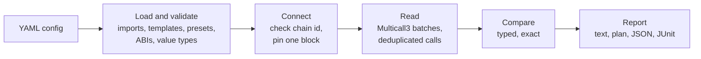

<p align="center">
  <picture>
    <source media="(prefers-color-scheme: dark)" srcset=".github/assets/logo-dark.svg">
    
  </picture>
</p>

<p align="center">
  <b>Declare the on-chain state you expect. Get told when it drifts.</b><br>
  Owners, roles, proxies, parameters and balances of deployed contracts, checked in CI against a YAML file.
</p>

<p align="center">
  <a href="https://github.com/devjoinedthechat/nodrift/actions/workflows/ci.yml"></a>
  <a href="LICENSE"></a>
  <a href="#install"></a>
  <a href="tsconfig.json"></a>
  <a href="#how-it-works"></a>
</p>

<p align="center">
  <a href="#install">Install</a> ·
  <a href="#quick-start">Quick start</a> ·
  <a href="docs/README.md">Documentation</a> ·
  <a href="docs/state-types.md">Check types</a> ·
  <a href="docs/ci-cd-integration.md">CI setup</a> ·
  <a href="examples/">Examples</a>
</p>

---

Deployed contracts change after deployment: ownership moves, roles get granted, proxies are upgraded, fees and caps are tuned by governance or by a compromised key. **nodrift** reads that state from the chain and compares it with what you wrote down, so a change nobody expected fails a CI job instead of going unnoticed.

```text
$ nodrift examples/basic/05-drift-demo.yaml
nodrift v0.1.0 · examples/basic/05-drift-demo.yaml
chain 1 via ethereum-rpc.publicnode.com · block 26192883 · multicall

USDC  0xA0b8…eB48 · chain 1
  ✓ symbol        USDC
  ✓ decimals      6
  ✓ owner()       0xFcb19e6a322b27c06842A71e8c725399f049AE3a
  ✓ masterMinter  0xE982615d461DD5cD06575BbeA87624fda4e3de17
  ✓ paused        false
  ✗ totalSupply   [MEDIUM] usdc_supply
      actual    48168971338837518
      expected  25000000000000000 (± 10%)

6 checks: 5 passed, 1 drifted, 0 errors · 1 contract · 1903 ms
```

> [!NOTE]
> nodrift is at version 0.x. The config format may still change before 1.0; every change is listed in the [changelog](CHANGELOG.md).

## Features

- **One consistent snapshot.** Each network is read at a single pinned block (`latest`, `safe`, `finalized` or a number), after checking that the RPC endpoint is on the chain you configured.
- **Few requests.** Calls are batched through [Multicall3](https://www.multicall3.com) when it is deployed, and identical calls are made once.
- **Exact comparisons.** Expected values are typed against the ABI and compared as integers, so a uint256 is never rounded through a float. Tolerances, ranges, operators and regular expressions are there for when exact equality is not what you want.
- **Configs are checked before they run.** Unknown keys, bad address checksums, missing functions and mistyped values are reported with their exact location. `nodrift validate` does this offline.
- **Failures are never silent.** A check that cannot be read (revert, missing code, unreachable RPC) is an error with its own exit code, not a pass.
- **Read-only and safe on untrusted configs.** No transactions, no command execution from configs, file references confined to the project, and RPC URLs reduced to their host in every report and error.
- **Reports for people and machines.** Terminal output, a Terraform-style plan, JSON with exact integers, and JUnit XML for CI test views.

## Install

nodrift needs Node.js 22.13 or newer. It is not published to the npm registry yet; npm fetches it from GitHub and builds it on first use.

Try it without installing:

```bash
npx --yes github:devjoinedthechat/nodrift --version
```

Add it to a project (the lockfile records the exact commit):

```bash
npm install --save-dev github:devjoinedthechat/nodrift
npx nodrift --version
```

For a global `nodrift` command, build it from source:

```bash
git clone https://github.com/devjoinedthechat/nodrift.git
cd nodrift
npm ci       # installs dependencies and builds dist/
npm link     # puts `nodrift` on your PATH
```

Commands below are written as `nodrift`; use `npx nodrift` inside a project, or `npx --yes github:devjoinedthechat/nodrift` without an install. To pin a version, add a commit: `github:devjoinedthechat/nodrift#<commit>`. `npm install --global github:devjoinedthechat/nodrift` does not work, because npm cannot build a global install from git.

## Quick start

Save this as `nodrift.yaml`. It checks USDC on Ethereum mainnet: who controls it, whether it is paused, and that no unexpected mint has pushed the supply past a ceiling.

```yaml
# yaml-language-server: $schema=https://raw.githubusercontent.com/devjoinedthechat/nodrift/main/nodrift.schema.json
network:
  rpc_url: ${RPC_URL}
  chain_id: 1

contracts:
  USDC:
    address: '0xA0b86991c6218b36c1d19D4a2e9Eb0cE3606eB48'
    preset: erc20
    state:
      - type: owner
        value: '0xFcb19e6a322b27c06842A71e8c725399f049AE3a'
      - type: variable
        name: 'masterMinter() returns (address)'
        value: '0xE982615d461DD5cD06575BbeA87624fda4e3de17'
      - type: variable
        name: 'paused() returns (bool)'
        value: false
      - type: variable
        name: decimals
        value: 6
      - type: variable
        name: totalSupply
        value: '100000000000000000' # 100B USDC
        options:
          comparison: '<'
          description: no unexpected mint
```

Point it at any Ethereum mainnet RPC endpoint and run it:

```bash
export RPC_URL=https://ethereum-rpc.publicnode.com   # or your own endpoint, or a .env file next to the config
nodrift validate nodrift.yaml                         # offline: schema, ABI lookups, value types
nodrift nodrift.yaml                                  # read the chain and compare
```

```text
nodrift v0.1.0 · nodrift.yaml
chain 1 via ethereum-rpc.publicnode.com · block 26192946 · multicall

USDC  0xA0b8…eB48 · chain 1
  ✓ owner()       0xFcb19e6a322b27c06842A71e8c725399f049AE3a
  ✓ masterMinter  0xE982615d461DD5cD06575BbeA87624fda4e3de17
  ✓ paused        false
  ✓ decimals      6
  ✓ totalSupply   48164427836516894 (no unexpected mint)

5 checks: 5 passed, 0 drifted, 0 errors · 1 contract · 2122 ms
```

Change an expected value and run it again to see drift, or try `--plan` and `--output json`. `nodrift init` builds a starter config for your own contracts interactively and can fetch verified ABIs from Etherscan.

## Checks for your own contracts

Functions come from a [preset](docs/presets.md), an ABI file (plain ABI or a Foundry/Hardhat artifact), or an inline signature such as `"balanceOf(address) returns (uint256)"`, so most configs need no ABI files. Addresses and other values can come from environment variables:

```yaml
network:
  rpc_url: ${RPC_URL}
  chain_id: 1

contracts:
  Vault:
    address: '${VAULT_ADDRESS}'
    preset: erc4626
    state:
      - type: owner
        value: '${MULTISIG}'
      - type: proxy
        checks:
          implementation: '${VAULT_IMPLEMENTATION}'
      - type: role
        role: PAUSER_ROLE
        account: '${GUARDIAN}'
      - type: variable
        name: asset
        value: '0xA0b86991c6218b36c1d19D4a2e9Eb0cE3606eB48'
      - type: function_call
        function: 'withdrawalFee() returns (uint256)'
        value: 50
        options:
          comparison: '<='
          description: fee in basis points, at most 0.5%
```

## What you can check

| Type             | Checks                                                                  | Example                                        |
| ---------------- | ----------------------------------------------------------------------- | ---------------------------------------------- |
| `owner`          | `owner()` (falls back to `getOwner()`)                                  | `value: "0x…"`                                 |
| `role`           | `hasRole(role, account)`, or the exact member set of an enumerable role | `role: MINTER_ROLE`, `account: "0x…"`          |
| `variable`       | a public variable or zero-argument getter                               | `name: paused`, `value: false`                 |
| `function_call`  | any view function, with arguments and a selected output                 | `function: balanceOf`, `args: ["0x…"]`         |
| `storage_slot`   | a raw slot or a packed field in it                                      | `slot: 0`, `options: { offset: 20, size: 12 }` |
| `proxy`          | ERC-1967 implementation, admin and beacon slots                         | `checks: { implementation: "0x…" }`            |
| `array_state`    | length, membership, exact contents of an array return value             | `checks: { contains: ["0x…"] }`                |
| `mapping_state`  | several keys of a mapping getter, including nested mappings             | `keys: [{ key: "0x…", value: 1 }]`             |
| `cross_contract` | a function of another contract in the config                            | `target_contract: Token`                       |
| `aggregate`      | `sum`, `count`, `average`, `min` or `max` over several reads            | `operation: sum`                               |
| `comparison`     | two reads (or a read and a constant) against each other                 | `operator: ">="`                               |
| `conditional`    | different checks depending on a condition                               | `condition: { name: paused, value: true }`     |
| `time_based`     | how old a timestamp is, relative to the pinned block                    | `max_age_seconds: 3600`                        |

Values can be compared with `==` (default), `!=`, `>`, `>=`, `<`, `<=`, an absolute or relative `tolerance`, a `range`, or a regular expression `pattern`. Integers can be written as `1000`, `"1_000"`, `"0x3e8"`, `"1e21"`, `"1.5 ether"` or `"30 gwei"`. See [check types](docs/state-types.md) and [comparison options](docs/comparison-options.md).

## Command line

```text
nodrift [verify] <config>   read on-chain state and compare it with the config
nodrift validate <config>   check a config offline
nodrift init [output]       create a config interactively
nodrift presets             list built-in ABI presets
```

| Option                  | Description                                                              |
| ----------------------- | ------------------------------------------------------------------------ |
| `-o, --output <format>` | `text` (default), `json` or `junit`                                      |
| `--junit-file <path>`   | where `--output junit` writes (default `test-results/nodrift-junit.xml`) |
| `--fail-on-drift`       | exit with code 1 when drift is found                                     |
| `--plan`                | Terraform-style plan of drifted state                                    |
| `--block <block>`       | read at `latest`, `safe`, `finalized` or a block number                  |
| `-q, --quiet`           | only print drift, errors and the summary                                 |
| `--compact-json`        | single-line JSON                                                         |
| `--no-env-file`         | do not load `.env`                                                       |
| `-v, --verbose`         | log RPC activity to stderr                                               |

| Exit code | Meaning                                                              |
| --------- | -------------------------------------------------------------------- |
| `0`       | all checks passed (or drift found without `--fail-on-drift`)         |
| `1`       | drift found and `--fail-on-drift` set                                |
| `2`       | invalid command-line arguments, or the config file could not be read |
| `3`       | RPC endpoint unreachable, or on a different chain than configured    |
| `4`       | at least one check could not be evaluated (always non-zero)          |
| `5`       | config failed validation                                             |
| `6`       | unexpected internal error                                            |

## In CI

```yaml
# .github/workflows/drift.yml
name: Contract drift
on:
  schedule: [{ cron: '0 * * * *' }]
  workflow_dispatch:

jobs:
  nodrift:
    runs-on: ubuntu-latest
    steps:
      - uses: actions/checkout@v7
      - uses: actions/setup-node@v7
        with:
          node-version: 22
      - run: npx --yes github:devjoinedthechat/nodrift nodrift.yaml --fail-on-drift --output junit --junit-file test-results/nodrift.xml
        env:
          RPC_URL: ${{ secrets.RPC_URL }}
      - uses: actions/upload-artifact@v7
        if: always()
        with:
          name: nodrift-report
          path: test-results/
```

More setups (GitLab, pull request checks, JSON output for alerting) are in [CI integration](docs/ci-cd-integration.md).

## How it works



Everything up to "Connect" happens offline, which is what `nodrift validate` runs. Details and design decisions are in [architecture](docs/architecture.md).

## As a library

```bash
npm install github:devjoinedthechat/nodrift
```

```ts
import { loadConfig, renderText, verify } from 'nodrift';

const result = await verify(loadConfig('nodrift.yaml'), { block: 'finalized' });
console.log(renderText(result));
if (result.summary.drifted > 0 || result.summary.errors > 0) process.exitCode = 1;
```

`result.results` holds one entry per check with its status (`pass`, `drift`, `error` or `skipped`), the actual value and the expectation.

## Development

```bash
npm ci
npm test            # unit tests, plus end-to-end tests when Foundry's anvil is installed
npm run lint && npm run typecheck
npm run dev -- validate examples/basic/01-erc20-token.yaml
```

See [CONTRIBUTING.md](CONTRIBUTING.md) for the project layout and conventions. Security issues: please follow [SECURITY.md](SECURITY.md).

## License

[MIT](LICENSE)
